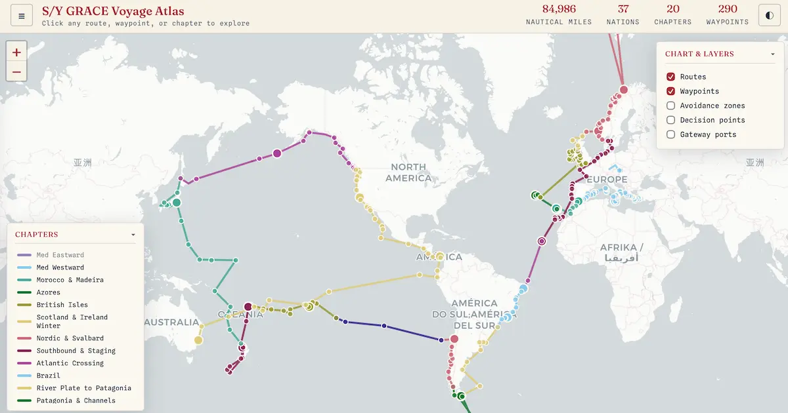

# Voyage Atlas

Voyage Atlas is a pair of self-contained web tools for charting a long voyage as a sequence of **chapters**, groupings of waypoints by region and season. An editor creates and maintains the voyage file; a read-only viewer charts it for sharing or publishing. It is made for cruisers charting ocean passages and multi-year voyages, and is generic enough for any voyage. The project's home page, with the story behind the tool, is at [sailingamazinggrace.com/resources/voyage-atlas](https://sailingamazinggrace.com/resources/voyage-atlas).

## Project status

Stable and actively maintained. Each release is recorded in the [CHANGELOG](CHANGELOG.md); bugs and suggestions go to the [issue tracker](https://github.com/Peter-Petrik/voyage-atlas/issues).

## Features

1. **Editor** (`voyage-atlas-editor.html`) — creates and maintains a voyage: chapters, waypoints, route geometry and voyage metadata, with chart and table editing, geocoding and drag-to-reorder, and JSON, CSV and KML export. The published editor is at [sailingamazinggrace.com/resources/voyage-atlas/editor](https://sailingamazinggrace.com/resources/voyage-atlas/editor).
2. **Viewer** (`voyage-atlas.html`) — a read-only interactive chart of a voyage, which is what gets published or shared. A full voyage is charted at [sailingamazinggrace.com/resources/voyage-atlas/viewer](https://sailingamazinggrace.com/resources/voyage-atlas/viewer).
3. **Single files** — both are single HTML files, with no build step, no framework and no server code. They run from any static host or a local HTTP server; opened straight from disk, each opens to its chooser, where a voyage file is loaded by hand.
4. **Chapters** group waypoints by region and season. Each is drawn in its own palette color, solid when past or current and dashed when planned, and carries an era (past, current or future), a When (season window), a pad multiplier, an optional blog link, notes, countries and key destinations.
5. **Unified waypoint model** — one ordered list per chapter; named rows render as markers, and rows with no name (empty or only spaces) act as shaping vertices that bend the route line without cluttering the chart.
6. **Three independent emphasis flags** per waypoint — Major (M), Gateway (G) and Decision (D) — each with its own marker on the chart.
7. **Distance with a pad multiplier** per chapter (accounting for tacking and cruising-ground exploration a straight-line track undercounts), plus an inter-chapter approach leg attributed to the destination chapter. All distances can display in nautical miles, kilometers or miles (stored as nautical miles).
8. **Endpoint sync** — chapters connect end to start. Each chapter header shows 🔗 when the chapter begins where the previous one ended, and ⇄ when there is a gap; clicking ⇄ copies the previous chapter's last waypoint in as a new first row.
9. **Geocoding** via OpenStreetMap's Nominatim, paced to one request a second — a name typed into a row with no coordinates fills them, and countries are looked up from positions.
10. **Automatic nation and territory classification** against a built-in reference list, with manual overrides.
11. **Import and export** — JSON (the master file) in both directions; a chapters and waypoints CSV pair in both directions, for spreadsheet editing, without the title, settings or avoidance zones; and KML out, for Google Earth.
12. **Self-hosting** — a published chart needs only `voyage-atlas.html` and its `voyage-data.json` in one directory on any static host; add `voyage-atlas-editor.html` to offer the editor too. The viewer shows its voyage on arrival when served over HTTP, with the source file set by the `URL_VOYAGE_DATA` constant or a `?data=` parameter (a file on the same site).
13. **Viewer** — a header **Load…** button and a "Chart your own voyage" link to the editor (both fold into the Voyage Chapters drawer on small screens); the chooser can be dismissed by its close button, a tap outside it or Escape when a voyage is already shown; on load the chart frames the whole voyage when it fits, or for a voyage that wraps the globe it opens on the current chapter and the passages ahead; a chapter's detail panel links to the blog posts covering it when a link is set; and `?import=yes` opens the chooser for loading a different voyage file.
14. **Editor at a glance** — each chapter row opens a metadata form (📋) and a waypoint table (📍); controls above the chapter list open or close every form or table at once and look up the countries of every chapter; the waypoint table adds rows singly, in a batch or by pasting from a spreadsheet; and Rapid click, below the chart, places a waypoint with each click. The [FAQ](docs/voyage-atlas-faq.md) covers each in full.

## Configuration

Both tools keep their self-hosting settings in a labeled configuration block at the top of the script — for the viewer, immediately after the opening `<script>` tag; for the editor, at the top of the `CONSTANTS` section. Editing the values there points a copy at different data, basemaps, a basemap key, a different geocoder or its own editor; the rest of the script is untouched. An unedited copy uses the defaults shown.

| Constant | Tool | Default | Purpose |
|----------|------|---------|---------|
| `URL_VOYAGE_DATA` | both | `voyage-data.json` | The voyage file, on the same site as the tool: a relative path (a subdirectory or sibling folder is fine) or a full address on the same host. The viewer displays it on arrival; the editor's chooser offers it as the sample. A file on another site is not loaded. The `?data=path` query parameter overrides it for a single visit, under the same rule. |
| `URL_TILE_LIGHT` | both | CARTO Positron | The day basemap tile layer. |
| `URL_TILE_DARK` | both | CARTO Dark Matter | The night basemap tile layer. |
| `TILE_KEY` | both | empty | The basemap API key, added to every tile request when set. A key supplied by the hosting server at run time as `window.VOYAGE_ATLAS_CONFIG.tileKey` takes precedence. |
| `URL_EDITOR` | viewer | the published editor | The editor that the "Chart your own voyage" links open, in the header and the Voyage Chapters drawer. |
| `URL_GEOCODE` | editor | `https://nominatim.openstreetmap.org` | The geocoder base URL, used for name-to-coordinate search and reverse country lookup. Any Nominatim-compatible instance can be used. |

CARTO serves its basemap tiles only with an API key. A key is free for most sites and is requested at [carto.com/basemaps/apikey](https://carto.com/basemaps/apikey/); each site needs its own. Without a key the chart still works, but every tile carries an "API key required" watermark. A hosting server can supply the key at run time instead of editing the file, by defining `window.VOYAGE_ATLAS_CONFIG = { tileKey: "…" }` in a plain inline script (not `async`, `defer` or a module) placed before the tool's own script, for example at the end of the page head, since each tool reads the key once, as its chart is set up; the published site does this, so its key stays out of the repository.

If the tile URLs are changed to another provider, the attribution string on the tile layers (the configuration block's comment points to them) is changed to match that provider's terms. The editor's geocoding requests are paced at one per second to comply with the public Nominatim usage policy; that pacing is fixed in the request queue and is intentionally not a configurable value.

The canonical, `og:url`, `og:image` and `twitter:image` tags in each page's head name the published site, under a comment that marks them for self-hosters; a self-hosted copy points them at its own address, serving the preview image from its copy of `docs/voyage-atlas-preview.webp`.

## Prerequisites

1. A current desktop or mobile browser for the viewer; for the editor, a desktop or laptop with a mouse.
2. Network access to `cdnjs.cloudflare.com`, from which both tools load Leaflet and the editor also loads SortableJS and PapaParse; a notice across the top of the page names any library that did not arrive.
3. For basemap tiles without a watermark, a CARTO basemap key (see Configuration).
4. For the viewer to show a voyage file on arrival, and for the editor to offer the sample, an HTTP server: the published site, any static host or a local one such as `python3 -m http.server`.
5. For the test suite only, Node.js (see Technical details).

## Quick start

1. Download `voyage-atlas-editor.html`, `voyage-atlas.html` and (optionally) the sample `voyage-data.json`, the icon assets and `site.webmanifest` into the same folder.
2. **To explore the sample:** serve the folder over HTTP (see Prerequisites) and open `voyage-atlas.html`. When `voyage-data.json` sits alongside it, the chart displays it on arrival; otherwise the viewer opens to a chooser for loading a voyage file.
3. **To start a new voyage:** open `voyage-atlas-editor.html`. It opens to a chooser; pick "Start a new voyage", add a chapter with **+ Add chapter**, and place waypoints by searching for a place, typing coordinates into a row or turning **Rapid click** on and clicking the chart. **Save** downloads `voyage-data.json`.
4. **To view a voyage:** put its `voyage-data.json` next to `voyage-atlas.html` and open the viewer, or load the file from the viewer's chooser, reachable any time from the header **Load…** button.

The repository ships with a small sample `voyage-data.json` (a five-chapter voyage from Turkey across the Mediterranean and the Atlantic) so the tools open to a working example. A full multi-year voyage is charted on the published viewer.

## Technical details

### The data path and `file://`

Each tool resolves its voyage from a `URL_VOYAGE_DATA` constant in the configuration block at the top of its script (`voyage-data.json` by default); a `?data=path` query parameter overrides it for one visit. Either may be a relative path or a full address on the same site (same protocol and host); a file on another site is not loaded. A `?data=` value that points to another site (an absolute address on another host, a `//host` address or a scheme such as `data:`) is refused, and the chooser opens with a note that voyage files must be on this site. Opened straight from disk (a `file://` address), neither tool can read the voyage file beside it: each opens to its chooser with a note saying so, where a voyage file can be loaded, and the editor's chooser has no sample option.

### Icon assets

The repository also ships optional icon assets (`favicon.svg`, `favicon.ico`, the `favicon-*.png`, `apple-touch-icon.png` and `android-chrome-*.png` images) and `site.webmanifest`, for the tab icon and home-screen icons. A copy hosted without them runs the same.

### Data correctness

The atlas shows exactly what is entered and corrects nothing; accuracy of the data is the navigator's responsibility (see the FAQ, "Why is data correctness the navigator's responsibility?").

### Tests

The test suite runs with `node --test test/*.test.js` from the repository root, with nothing to install, on Node.js 24, the version CI runs. It runs on every push and pull request to `main` and before every release.

### Documentation

1. [FAQ / Owner's Manual](docs/voyage-atlas-faq.md) — the full reference for both tools (concepts, editor, viewer and design principles), and the place to start.
2. [Data schema](docs/voyage-atlas-schema.md) — the voyage file, CSV and KML format contract, for hand-editing data or for other tools that read or write it.
3. [Changelog](CHANGELOG.md) — version history.

The design rationale (why chapters, the distance model, the self-contained files) is in the FAQ's Concepts and Design principles parts, and the predecessor seam is described at `getPredecessorChapter` in both tools.

## Future enhancements

Planned features, none of them present yet, and closed ideas with the reason for each are kept in the [enhancements backlog](docs/voyage-atlas-enhancements.md). Item numbers there are stable and are cited from the CHANGELOG and the other documents.

## Support

Bugs and feature suggestions go to the [issue tracker](https://github.com/Peter-Petrik/voyage-atlas/issues). A code change is best raised in an issue first, to discuss it before work starts.

## Screenshots

The viewer, with a voyage charted as chapters.

## License

Copyright (C) 2026 Peter Petrik

This program is free software: you can redistribute it and/or modify it under the terms of the GNU General Public License as published by the Free Software Foundation, either version 3 of the License, or (at your option) any later version.

This program is distributed in the hope that it will be useful, but WITHOUT ANY WARRANTY; without even the implied warranty of MERCHANTABILITY or FITNESS FOR A PARTICULAR PURPOSE. See the GNU General Public License for more details.

You should have received a copy of the GNU General Public License along with this program (see the [`LICENSE`](LICENSE) file). If not, see <https://www.gnu.org/licenses/>.
