# Voyage Atlas — Visual Guide

This guide draws Voyage Atlas: the two tools, their screens, the steps of charting a voyage and what happens beneath each step. It is a companion to the [FAQ / Owner's Manual](voyage-atlas-faq.md), which describes every feature in full; each figure links to the FAQ sections it illustrates.

The figures are arranged in four layers, numbered from 0, each a level deeper than the one before:

| Layer | What it draws |
|-------|---------------|
| 0 — The whole | The two tools and the voyage file between them. |
| 1 — The screens | Each tool's layout, with numbered callouts. |
| 2 — Charting a voyage | The steps from a blank chart to a published one. |
| 3 — Beneath the surface | The model and the rules each step follows. |

Figure numbers are fixed. Each figure has its own address, such as `voyage-atlas-guide.md#fig-2-4` for Figure 2.4, which stays the same when figures are added: a new figure takes the next free number in its layer, and the number of a figure taken out is not used again. The screens in Layer 1 are drawn with the sample voyage that comes with the tools (`voyage-data.json`), with the version in their footers written as vX.Y.Z, and follow the light or dark theme of the page they are read on.

## Figures

**Layer 0 — The whole**

1. [Figure 0.1: The two tools and the voyage file](#fig-0-1)

**Layer 1 — The screens**

1. [Figure 1.1: The editor screen](#fig-1-1)
2. [Figure 1.2: A chapter, part by part](#fig-1-2)
3. [Figure 1.3: The viewer screen](#fig-1-3)
4. [Figure 1.4: The viewer on a narrow screen](#fig-1-4)

**Layer 2 — Charting a voyage**

1. [Figure 2.1: Start to finish](#fig-2-1)
2. [Figure 2.2: Getting data in](#fig-2-2)
3. [Figure 2.3: Voyage Settings](#fig-2-3)
4. [Figure 2.4: Adding a chapter and its fields](#fig-2-4)
5. [Figure 2.5: Adding waypoints](#fig-2-5)
6. [Figure 2.6: Shaping the route](#fig-2-6)
7. [Figure 2.7: Joining chapters](#fig-2-7)
8. [Figure 2.8: Saving and exporting](#fig-2-8)
9. [Figure 2.9: Opening the voyage in the viewer](#fig-2-9)

**Layer 3 — Beneath the surface**

1. [Figure 3.1: Voyage, chapters and waypoints](#fig-3-1)
2. [Figure 3.2: Flags and marker shapes](#fig-3-2)
3. [Figure 3.3: How a chapter's distance is built](#fig-3-3)
4. [Figure 3.4: Which action looks up what](#fig-3-4)
5. [Figure 3.5: Countries, nations and territories](#fig-3-5)
6. [Figure 3.6: Era and the route line](#fig-3-6)
7. [Figure 3.7: Selecting a chapter in the viewer](#fig-3-7)

---

## Layer 0 — The whole

### Figure 0.1: The two tools and the voyage file

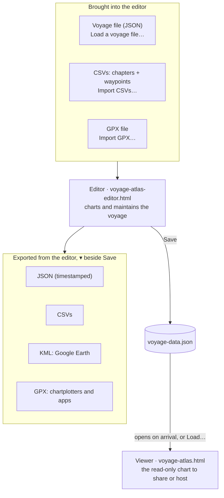

The editor is where a voyage is charted and maintained; the viewer is the read-only chart that is shared or hosted. They meet in one file, the voyage file, which the editor saves as `voyage-data.json` and the viewer loads. CSV and GPX also bring data into the editor, and CSV, KML and GPX carry it out to spreadsheets, Google Earth and chartplotters. The voyage file, saved with Save or as a dated copy, is the one format that carries the whole voyage; CSV, KML and GPX each carry a part of it (Figure 2.8).

FAQ: [Getting data in](voyage-atlas-faq.md#getting-data-in) · [Saving and exporting](voyage-atlas-faq.md#saving-and-exporting) · [Loading data](voyage-atlas-faq.md#loading-data) · [Why is the data separate from the tool?](voyage-atlas-faq.md#why-is-the-data-separate-from-the-tool)

---

## Layer 1 — The screens

### Figure 1.1: The editor screen

<picture>
  <source media="(prefers-color-scheme: dark)" srcset="images/guide-1-1-editor-dark.svg">
  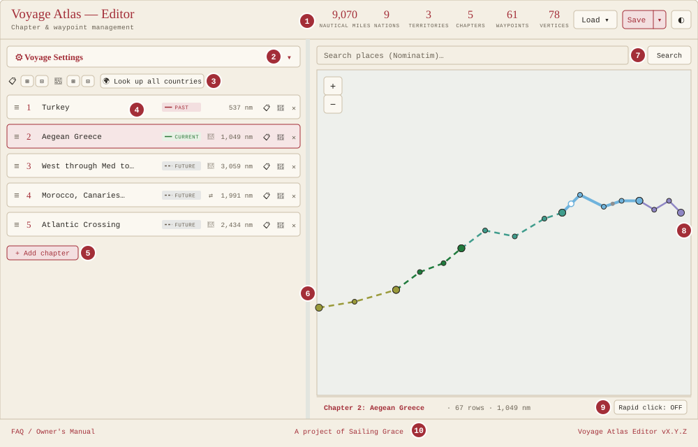
</picture>

Drawn with chapter 2 selected.

1. **Header** — the title, the voyage's header stats, **Load ▾**, **Save** with its **▾** menu, and **◐** for the light or dark theme. On a screen 900 px wide or less the stats are hidden.
2. **⚙ Voyage Settings** — the voyage-level settings; a click on its header opens or closes it (Figure 2.3).
3. **Panel controls** — **📋 ⊞ ⊟** opens or closes every chapter's metadata form, **📍 ⊞ ⊟** every waypoint table, and **🌍 Look up all countries** fills in missing countries across the voyage (Figure 3.4).
4. **Chapter list** — one header per chapter; a click on a header selects that chapter (Figure 1.2).
5. **+ Add chapter** — adds a chapter at the end of the voyage (Figure 2.4).
6. **Divider** — dragged to widen the chapter panel or the chart.
7. **Search** — place search through Nominatim for a name of two or more characters, sent on Enter or **Search** (Figure 2.5).
8. **Chart** — every chapter's route and markers, the selected chapter on top with its shaping vertices and ghost midpoints (Figure 2.6).
9. **Status bar** — what the editor has just done, or the selected chapter's rows and distance; the **Rapid click** toggle at its right, when ON, turns a click on the chart into a new waypoint (Figure 2.5).
10. **Footer** — links to the FAQ, the project site and the version's release notes.

FAQ: [Part 2 — Using the editor](voyage-atlas-faq.md#part-2--using-the-editor) · [Chapters](voyage-atlas-faq.md#chapters) · [Header stats](voyage-atlas-faq.md#header-stats)

### Figure 1.2: A chapter, part by part

<picture>
  <source media="(prefers-color-scheme: dark)" srcset="images/guide-1-2-chapter-dark.svg">
  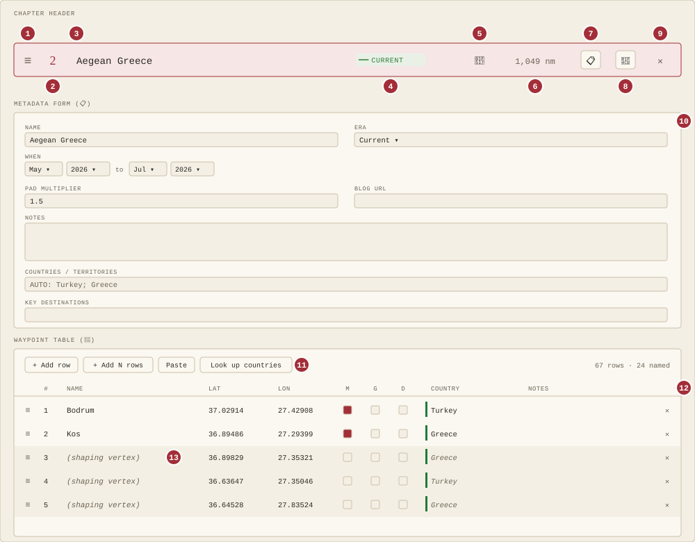
</picture>

Drawn for chapter 2 of the sample voyage, with its metadata form and waypoint table open. The chapter header, left to right:

1. **≡** — the drag handle, to reorder chapters.
2. **Chapter number.**
3. **Name.**
4. **Era chip** — Past, Current or Future, with a sample of the route line (Figure 3.6).
5. **Connection indicator** — 🔗 when the chapter starts where the one before ends, ⇄ when there is a gap to pull closed (Figure 2.7).
6. **Distance** — in the unit chosen in Voyage Settings (Figure 3.3).
7. **📋** — opens or closes the metadata form (10).
8. **📍** — opens or closes the waypoint table (11 to 13).
9. **✕** — deletes the chapter, after a confirmation.

The panels below it:

10. **Metadata form** — the chapter's eight fields, in the order of Figure 2.4.
11. **Waypoint toolbar** — **+ Add row**, **+ Add N rows**, **Paste** and **Look up countries**, then the count of rows and named waypoints (Figure 2.5).
12. **Columns** — ≡ (drag), #, Name, Lat, Lon, M, G, D, Country, Notes and ✕. M, G and D are the flags (Figure 3.2); a country cell that already holds a value is flagged, since a lookup leaves it alone (Figure 3.4).
13. **Shaping vertices** — rows with no name, shown as "(shaping vertex)"; they bend the route without drawing a marker (Figure 3.1).

FAQ: [Chapters](voyage-atlas-faq.md#chapters) · [Chapter metadata](voyage-atlas-faq.md#chapter-metadata) · [Waypoints](voyage-atlas-faq.md#waypoints)

### Figure 1.3: The viewer screen

<picture>
  <source media="(prefers-color-scheme: dark)" srcset="images/guide-1-3-viewer-dark.svg">
  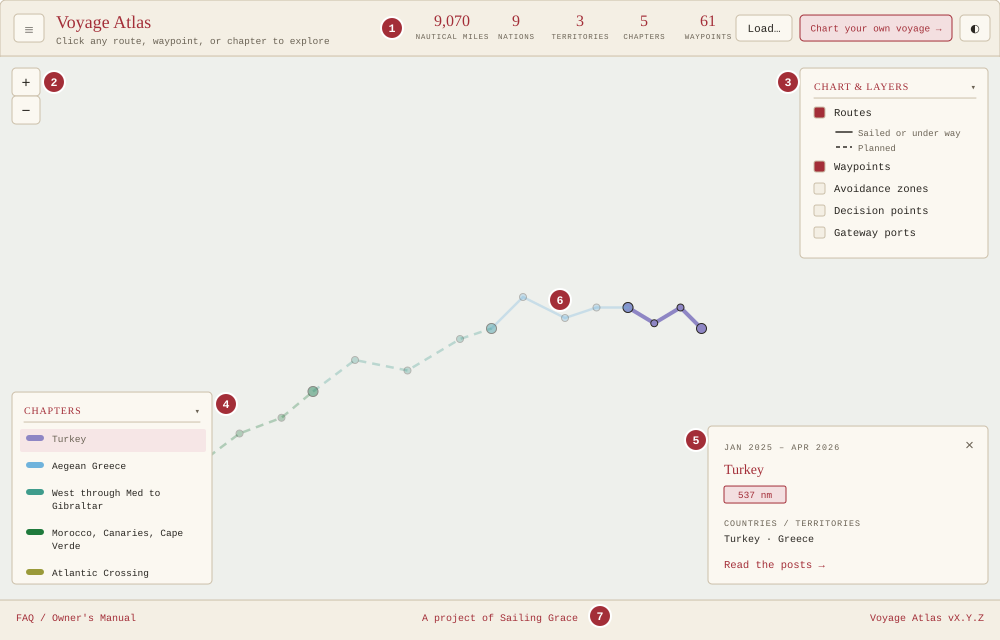
</picture>

Drawn with chapter 1 selected.

1. **Header** — **☰** opens the Voyage Chapters drawer; then the title, the header stats, **Load…**, **Chart your own voyage →**, which opens the editor, and **◐**.
2. **Zoom** — top-left.
3. **Chart & Layers** — top-right: the five layer toggles, with the key to solid and dashed routes under Routes (Figures 3.2 and 3.6).
4. **Chapters** — bottom-left: one row per chapter; a click selects it (Figure 3.7).
5. **Detail panel** — bottom-right, for the selected chapter: its When, name and distance, its notes when it has any, its countries and territories, and **Read the posts →** when its blog URL is a full http or https address.
6. **Chart** — the selected chapter at full strength, the others dimmed.
7. **Footer** — links to the FAQ, the project site and the version's release notes.

FAQ: [The chart's panels](voyage-atlas-faq.md#the-charts-panels) · [Layer toggles](voyage-atlas-faq.md#layer-toggles) · [Selecting a chapter](voyage-atlas-faq.md#selecting-a-chapter)

### Figure 1.4: The viewer on a narrow screen

<picture>
  <source media="(prefers-color-scheme: dark)" srcset="images/guide-1-4-viewer-narrow-dark.svg">
  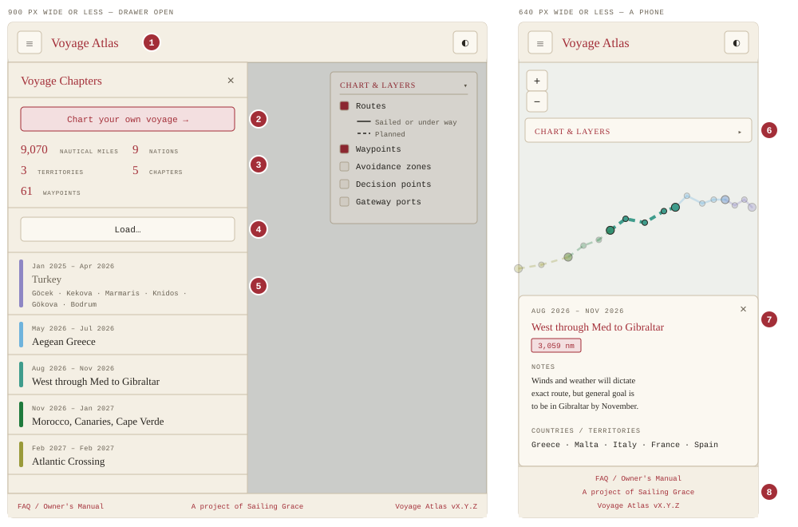
</picture>

On a screen 900 px wide or less:

1. **Header** — keeps **☰**, the title and **◐**.
2. **Chart your own voyage →** — moves into the Voyage Chapters drawer.
3. **Header stats** — move into the drawer, in two columns.
4. **Load…** — moves into the drawer.
5. **Chapter rows** — each with its When, name and key destinations; a past chapter is dimmed. Picking a chapter closes the drawer.

On a phone, 640 px wide or less:

6. **Chart & Layers** — runs across the top below the zoom control, starting collapsed. The Chapters list gives way to the ☰ drawer.
7. **Detail panel** — a sheet along the bottom, drawn for chapter 3.
8. **Footer** — stacks on three lines.

FAQ: [The chart's panels](voyage-atlas-faq.md#the-charts-panels) · [Selecting a chapter](voyage-atlas-faq.md#selecting-a-chapter)

---

## Layer 2 — Charting a voyage

### Figure 2.1: Start to finish

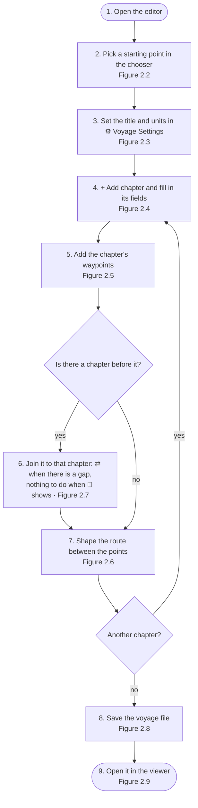

A voyage is charted one chapter at a time: each chapter gets its fields and its waypoints, joins the chapter before it once it has a point with coordinates, and has its route shaped. The voyage file is saved at any point and as often as needed; the Save button reads `Save *` while changes are unsaved.

FAQ: [Part 1 — Concepts](voyage-atlas-faq.md#part-1--concepts) · [Part 2 — Using the editor](voyage-atlas-faq.md#part-2--using-the-editor)

### Figure 2.2: Getting data in

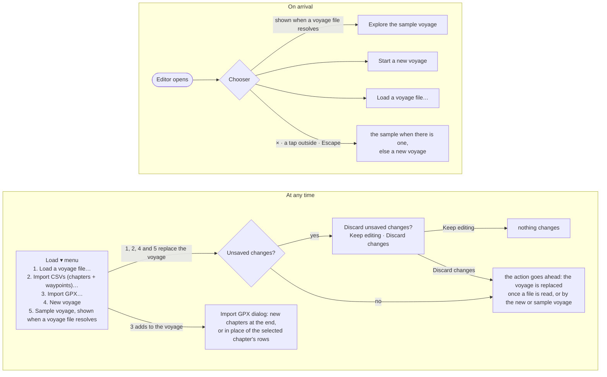

The chooser opens on every visit. The same actions, with CSV and GPX import, stay on the **Load ▾** menu. Every action that replaces the voyage asks first when there are unsaved changes, and Enter there keeps editing. GPX import adds to the voyage instead of replacing it. A voyage file that cannot be read is reported, and the voyage on screen stays as it was.

FAQ: [Getting data in](voyage-atlas-faq.md#getting-data-in)

### Figure 2.3: Voyage Settings

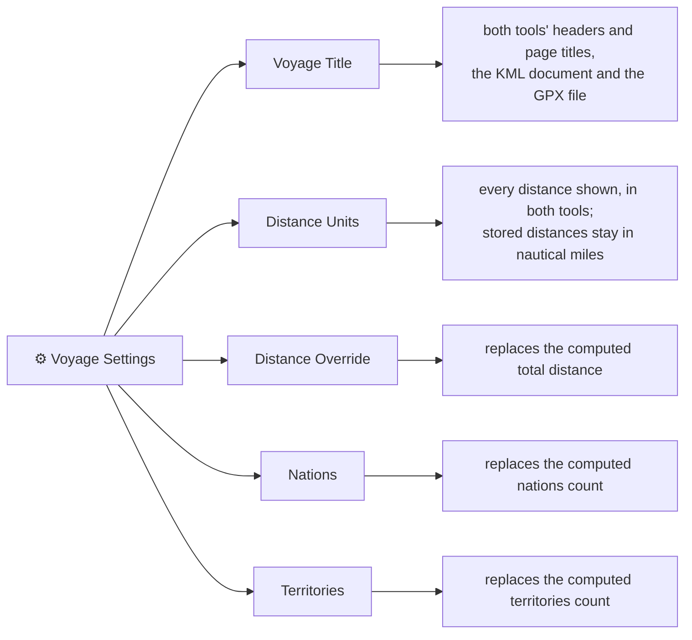

The settings belong to the whole voyage and are saved in the voyage file. A blank override leaves the computed figure. In the editor's header a set override is marked with a ⚙, and a Nations or Territories override of 0 still shows its tile; the viewer shows the figure without the mark, and no tile for 0. A Distance Override of 0 or less clears it. A blank title falls back to "Voyage Atlas".

FAQ: [Voyage Settings (⚙)](voyage-atlas-faq.md#voyage-settings-) · [How is distance (nm) calculated?](voyage-atlas-faq.md#how-is-distance-nm-calculated) · [How are nations and territories counted?](voyage-atlas-faq.md#how-are-nations-and-territories-counted)

### Figure 2.4: Adding a chapter and its fields

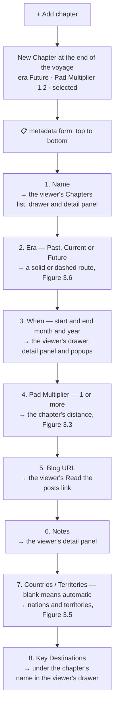

The fields are drawn in the order the form shows them, each with what it drives elsewhere after the →. A double-click on a chapter header also opens or closes its form.

FAQ: [Adding a chapter](voyage-atlas-faq.md#adding-a-chapter) · [Chapter metadata](voyage-atlas-faq.md#chapter-metadata)

### Figure 2.5: Adding waypoints

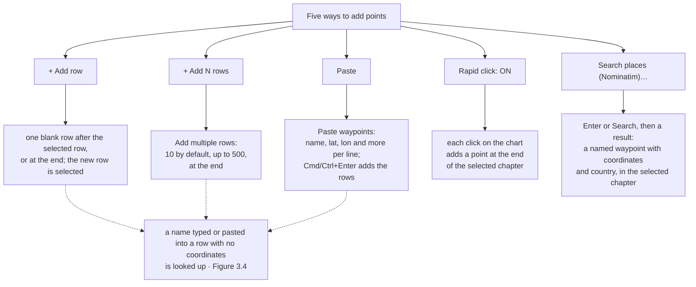

The toolbar buttons add to their own chapter. Rapid click and search add to the selected chapter, so a chapter is selected first; with none selected, a search pans the chart to the result and asks for a chapter. A ghost midpoint on the chart also adds a point (Figure 2.6), and Import GPX brings whole tracks and routes (Figure 2.2).

FAQ: [Adding waypoints](voyage-atlas-faq.md#adding-waypoints) · [Geocoding (name ↔ coordinates)](voyage-atlas-faq.md#geocoding-name--coordinates)

### Figure 2.6: Shaping the route

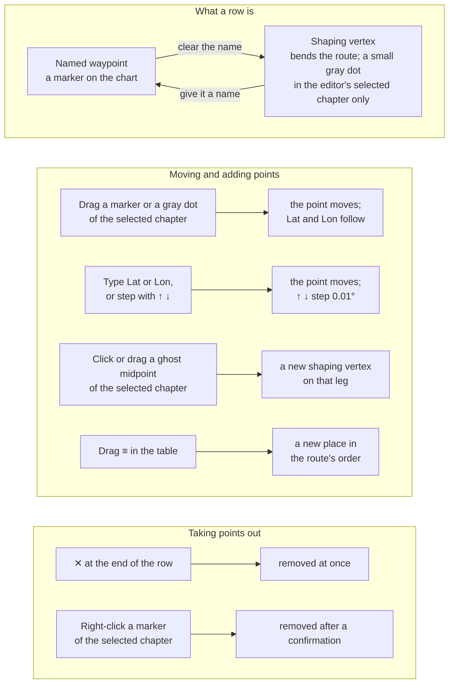

The route line joins every row of a chapter that has coordinates, in order, named or not. Shaping vertices bend it around a cape or along a coast without adding markers. A ghost midpoint is the faint marker halfway along each leg of the selected chapter, shown where the leg is long enough on screen to grab.

FAQ: [What is a "shaping vertex"?](voyage-atlas-faq.md#what-is-a-shaping-vertex) · [Adjusting waypoint positions](voyage-atlas-faq.md#adjusting-waypoint-positions) · [Reordering waypoints](voyage-atlas-faq.md#reordering-waypoints) · [Deleting waypoints](voyage-atlas-faq.md#deleting-waypoints)

### Figure 2.7: Joining chapters

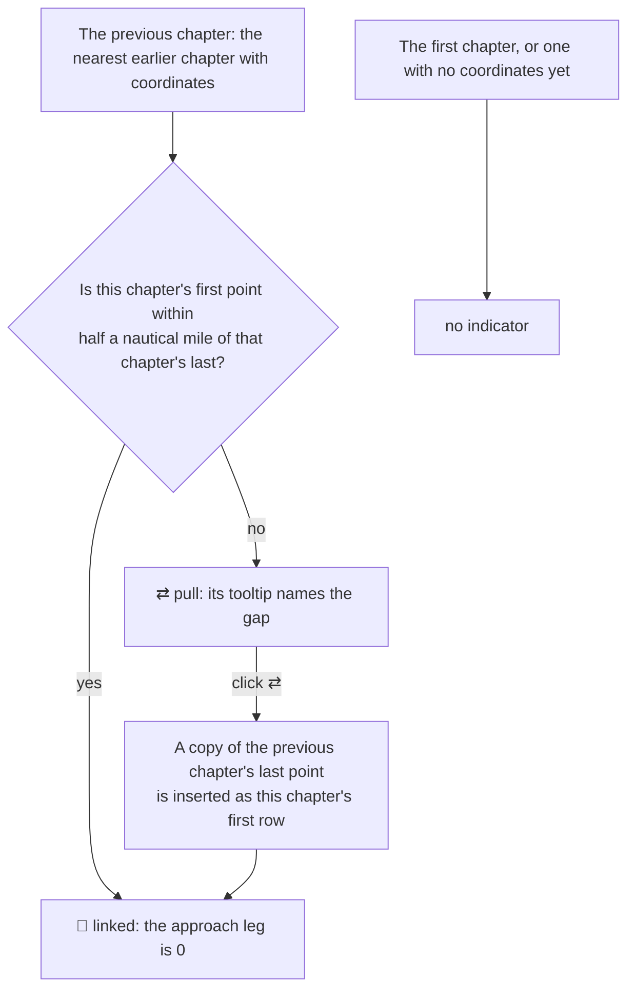

Chapters normally share their handoff point: the same point is the last row of one chapter and the first row of the next. The ⇄ button inserts that point rather than moving the existing first row, so a named waypoint is never moved. A gap left open is counted as the next chapter's approach leg (Figure 3.3).

FAQ: [How do chapters connect? (Shared endpoints)](voyage-atlas-faq.md#how-do-chapters-connect-shared-endpoints) · [Endpoint sync — the ⇄ button and 🔗 indicator](voyage-atlas-faq.md#endpoint-sync--the--button-and--indicator)

### Figure 2.8: Saving and exporting

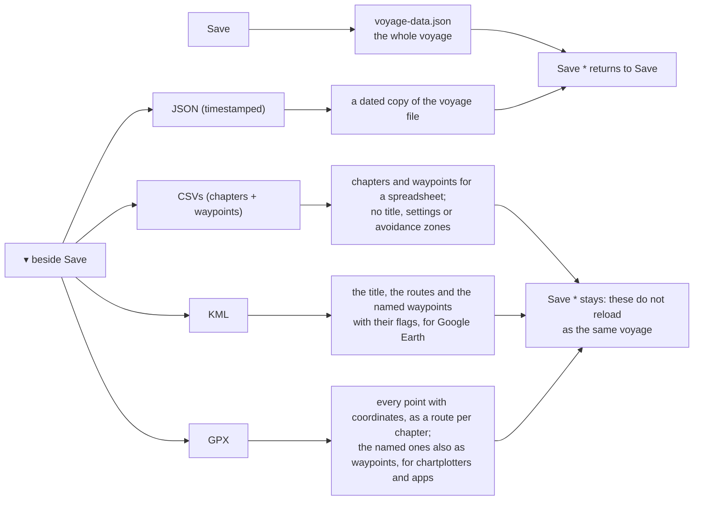

Only the voyage file is the complete record, and it holds only source data and overrides: every total, chapter distance and country list is computed again when a file loads. Each file from the ▾ menu carries the date and time in its name.

FAQ: [Saving and exporting](voyage-atlas-faq.md#saving-and-exporting) · [What do the header stats show?](voyage-atlas-faq.md#what-do-the-header-stats-show)

### Figure 2.9: Opening the voyage in the viewer

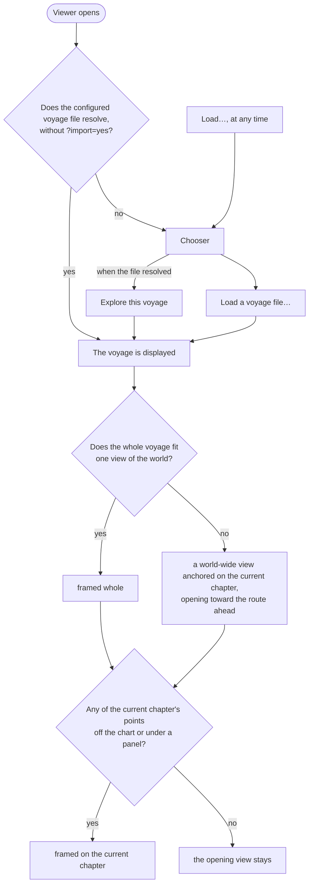

The viewer reads its voyage file the same way the editor does, from `voyage-data.json` beside it by default. The current chapter is, among the chapters with coordinates, the one whose era is Current, else the first Future chapter, else the last. To publish a voyage, `voyage-atlas.html` and the saved `voyage-data.json` go in one folder on a web host; replacing the file updates the chart. No chapter is selected on opening.

FAQ: [Loading data](voyage-atlas-faq.md#loading-data) · [Self-hosting](voyage-atlas-faq.md#self-hosting)

---

## Layer 3 — Beneath the surface

### Figure 3.1: Voyage, chapters and waypoints

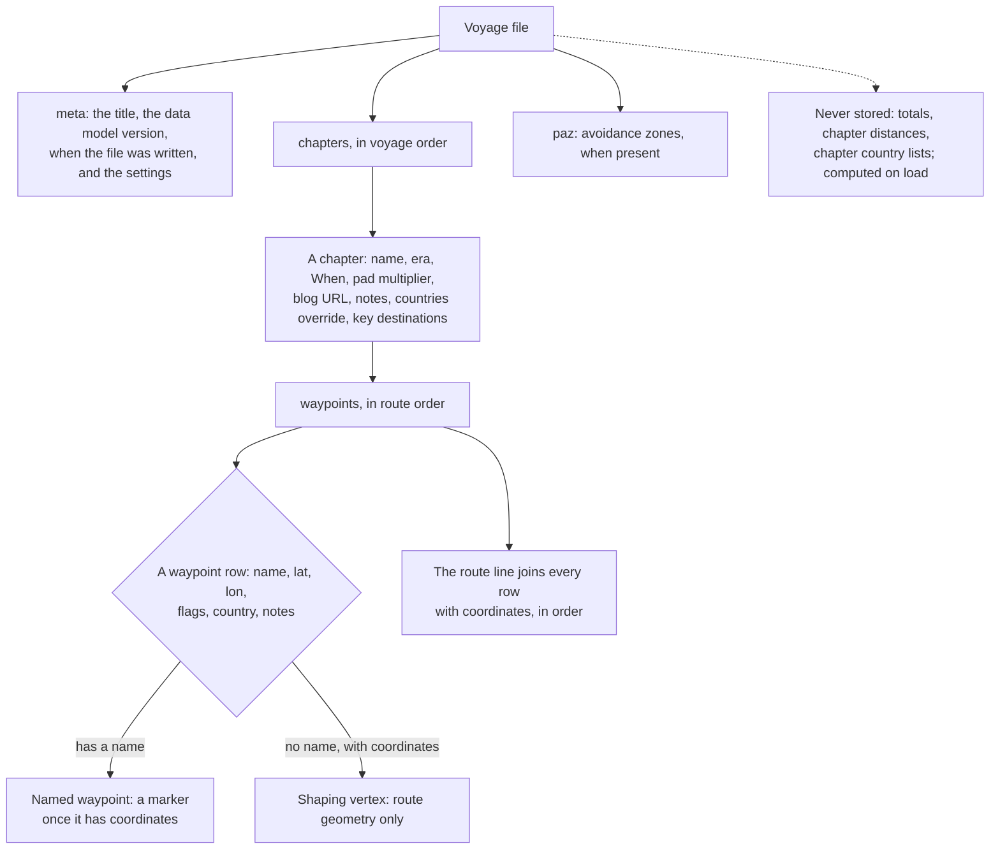

Only source data and explicit overrides are stored; everything calculated is worked out again each time a file loads, so a hand-edited file never shows a stale number. The full field list is in the [data schema](voyage-atlas-schema.md).

FAQ: [Why "chapters" instead of "legs"?](voyage-atlas-faq.md#why-chapters-instead-of-legs) · [What is a "shaping vertex"?](voyage-atlas-faq.md#what-is-a-shaping-vertex)

### Figure 3.2: Flags and marker shapes

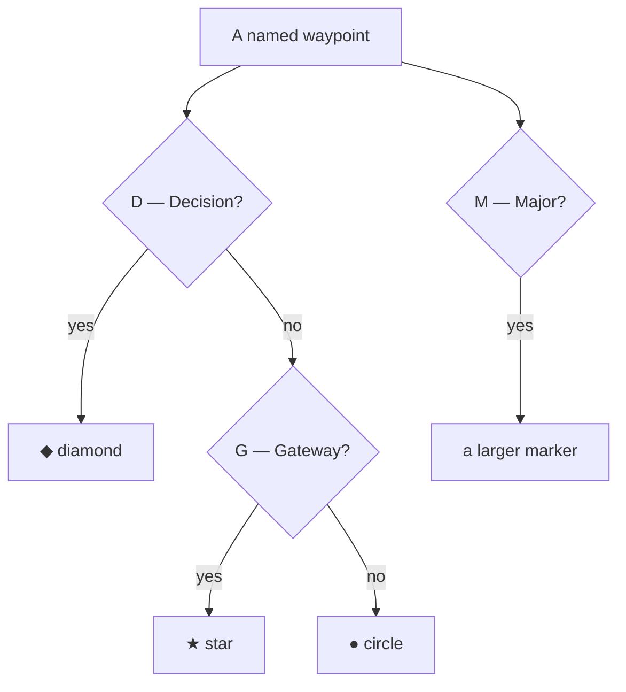

The three flags are independent. When more than one is set, the highest decides the shape: Decision, then Gateway. Major adds size. In the editor the diamond and the star show in the selected chapter; in the viewer they are drawn over the waypoint's circle when the **Decision points** and **Gateway ports** layers are on, which they are not by default. A shaping vertex ignores its flags.

FAQ: [What do the three waypoint flags mean?](voyage-atlas-faq.md#what-do-the-three-waypoint-flags-mean) · [Layer toggles](voyage-atlas-faq.md#layer-toggles)

### Figure 3.3: How a chapter's distance is built

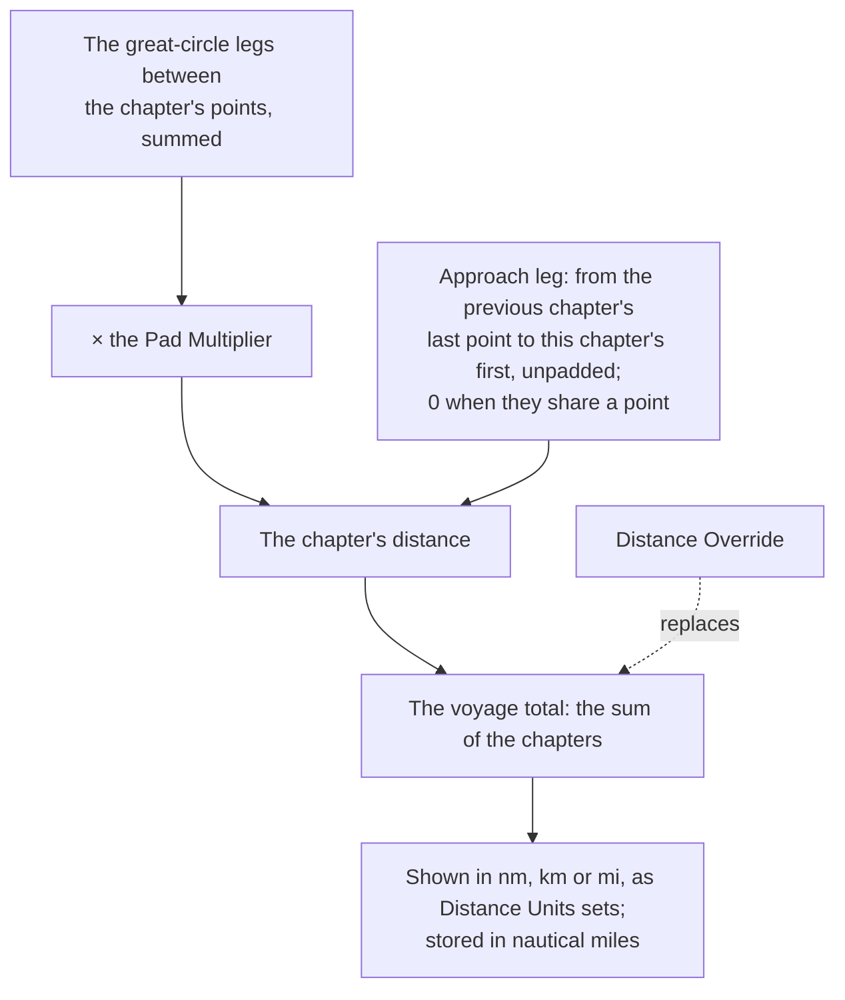

The pad accounts for the sailing a straight track undercounts, such as tacking and exploring a cruising ground; a new chapter starts at 1.2. The approach leg belongs to the chapter being sailed into, since the passage to its start is the first thing done in that chapter. A Distance Override replaces the total.

FAQ: [How is distance (nm) calculated?](voyage-atlas-faq.md#how-is-distance-nm-calculated) · [Why does the approach leg count toward the destination chapter?](voyage-atlas-faq.md#why-does-the-approach-leg-count-toward-the-destination-chapter)

### Figure 3.4: Which action looks up what

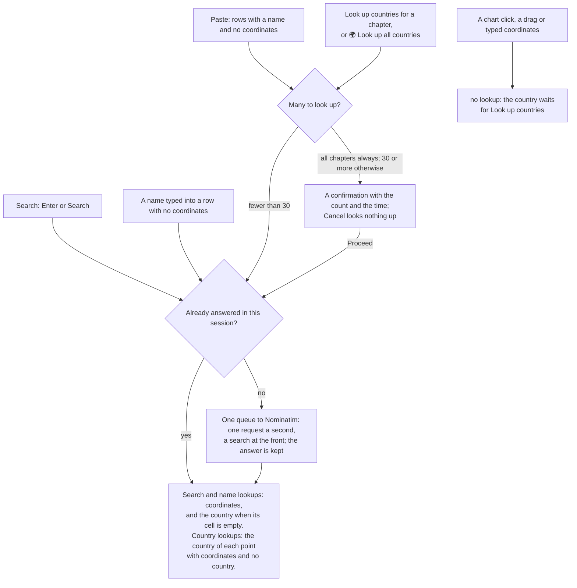

The country comes free with every search and name lookup; a lookup made only for countries runs only from the Look up countries buttons. A value typed by hand is never overwritten. A repeated lookup, such as Look up countries run again over points in open water, is answered from memory without a new request.

FAQ: [Geocoding (name ↔ coordinates)](voyage-atlas-faq.md#geocoding-name--coordinates) · [What leaves the browser?](voyage-atlas-faq.md#what-leaves-the-browser)

### Figure 3.5: Countries, nations and territories

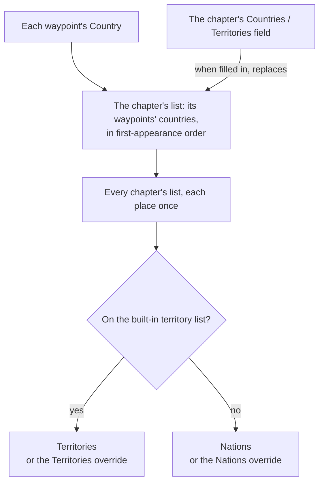

Names are matched however they are written, so a place spelled two ways counts once. The overrides in Voyage Settings replace the counts. A lookup can return the parent nation for a territory, such as Portugal for the Azores; the fix is the waypoint's Country or an override.

FAQ: [How are nations and territories counted?](voyage-atlas-faq.md#how-are-nations-and-territories-counted) · [Chapter metadata](voyage-atlas-faq.md#chapter-metadata)

### Figure 3.6: Era and the route line

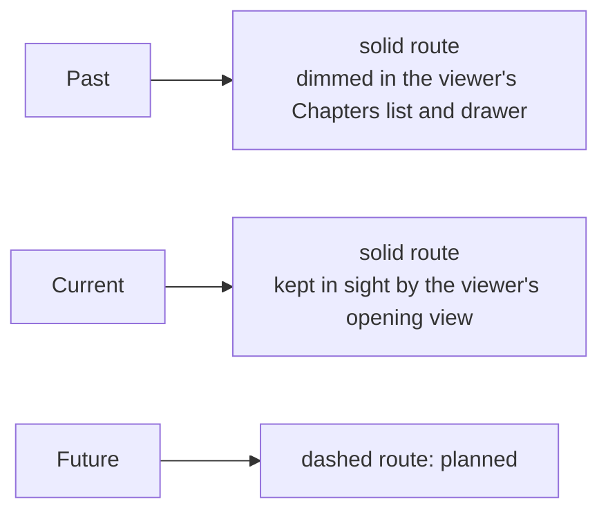

Both tools draw a future chapter's route dashed and the others solid, in the chapter's own color. The viewer's Chart & Layers panel shows the key under Routes, and each era chip in the editor shows a sample of its line. With no Current chapter among those with coordinates, the opening view keeps the first Future chapter in sight, else the last.

FAQ: [Chapter metadata](voyage-atlas-faq.md#chapter-metadata) · [Layer toggles](voyage-atlas-faq.md#layer-toggles)

### Figure 3.7: Selecting a chapter in the viewer

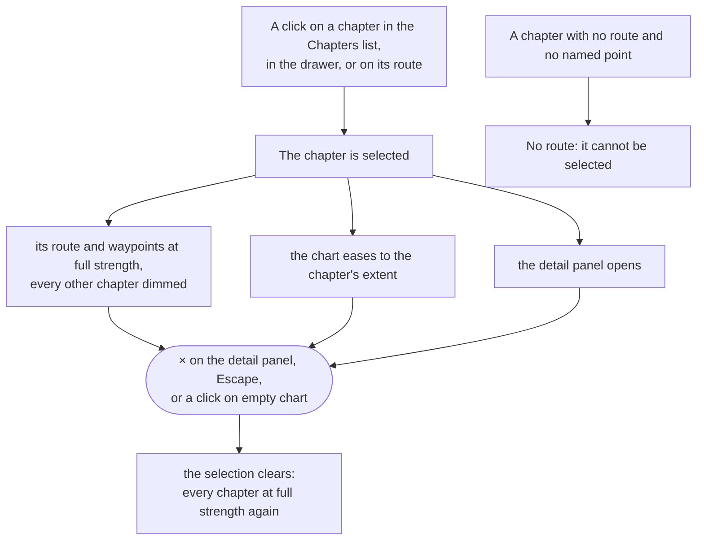

A selected chapter's waypoints sit above its route, so each can be clicked for its popup. On a phone, the chapter is framed between Chart & Layers and the detail sheet.

FAQ: [Selecting a chapter](voyage-atlas-faq.md#selecting-a-chapter) · [Reading the chart](voyage-atlas-faq.md#reading-the-chart)

---

*Companion documents: the [FAQ / Owner's Manual](voyage-atlas-faq.md) (every feature in full), the [data schema](voyage-atlas-schema.md) (the data format) and the [changelog](../CHANGELOG.md) (version history).*
